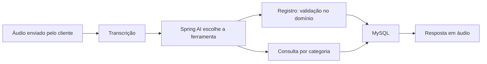

# Budgeting API com Spring AI

Projeto final da imersão Itaú/DIO. Parti da [API de orçamento desenvolvida na trilha](https://github.com/digitalinnovationone/dio-spring-boot-learning-track/blob/main/05-spring-ai/README.md), que recebe áudio e usa IA para registrar ou consultar transações. Minha principal evolução foi validar o valor na entidade `Transaction`: se o valor for zero ou negativo, o lançamento é recusado antes de chegar ao banco.

> **O que foi verificado:** os três testes unitários da regra de valores passaram em execução isolada com Java 25 e JUnit. O fluxo por voz com a Groq ainda não foi validado de ponta a ponta. O exemplo de áudio abaixo mostra como enviar a requisição; não é uma demonstração de resposta bem-sucedida.

## Minha contribuição

- **Validação no domínio:** o construtor usado para criar novas transações rejeita valores menores ou iguais a zero. Tanto a requisição REST quanto a ferramenta de registro chamada pela IA passam pelo mesmo caso de uso. A regra não depende do prompt.
- **Consulta sem lançamentos:** o caso de uso identifica quando não há registros na categoria consultada e sinaliza essa condição com uma mensagem explícita.
- **Configuração e exemplo:** a chave da Groq é recebida pela variável `GROQ_API_KEY`. O arquivo [`testes.http`](testes.http) mostra uma requisição de áudio para a API local.

## Fluxo da API



Além do fluxo por áudio (`POST /transactions/ai`), a API oferece registro via JSON (`POST /transactions`) e consulta por categoria (`GET /transactions/{category}`). Os valores no código são representados em **centavos**.

## Tecnologias

Java 25, Spring Boot 4, Spring AI, Groq (Llama 3.1 e Whisper), Spring Data JPA, MySQL, Docker Compose e Gradle Wrapper. A trilha separa domínio, casos de uso e infraestrutura.

## Como executar

Use JDK 25, Docker com Compose e uma chave própria da Groq. Execute a partir de `05-spring-ai`. O MySQL local está definido em `compose.yml`, que a integração Docker Compose do Spring Boot usa ao iniciar a aplicação.

```bash
cd 05-spring-ai
export GROQ_API_KEY='sua-chave'
./gradlew bootRun
```

No PowerShell, use `$env:GROQ_API_KEY = 'sua-chave'` e `.\gradlew.bat bootRun`. Não coloque a chave no Git. O fluxo por voz depende da disponibilidade dos serviços externos configurados.

## Como testar

Com a API local em execução, use o exemplo `testes.http` ou envie um áudio **fictício** pelo endpoint de voz:

```bash
curl -F 'file=@./audio-teste.mp3' \
  http://localhost:8080/transactions/ai --output resposta-teste.mp3
```

Para conferir a regra de negócio sem enviar áudio à Groq, envie uma requisição JSON com `"amount": 0` ao endpoint `POST /transactions`, usando uma categoria válida, como `GROCERIES`. O comportamento esperado é a rejeição e a ausência de um novo registro. Compare com um valor positivo, sempre no banco de desenvolvimento.

Os testes existentes são executados separadamente com `./gradlew test` (ou `.\gradlew.bat test` no Windows). Os testes que inicializam a aplicação ou integram serviços podem exigir a configuração local. O exemplo acima é uma verificação manual, não um teste automatizado da regra.

### Teste da regra do domínio (sem banco nem API de IA)

O [`TransactionTest`](src/test/java/dio/budgeting/domain/TransactionTest.java) chama a entidade diretamente e cobre três casos:

- `4500` centavos (R$ 45) são aceitos;
- `0` centavos são rejeitados;
- `-4500` centavos são rejeitados.

Com JDK 25, rode apenas essa classe a partir de `05-spring-ai`:

```bash
bash ./gradlew test --tests 'dio.budgeting.domain.TransactionTest'
```

No PowerShell, use `.\gradlew.bat test --tests 'dio.budgeting.domain.TransactionTest'`.

**Verificação:** 3 testes passaram em execução isolada com JDK 25 e JUnit, sem banco, áudio ou chamadas à Groq. A execução pelo Gradle Wrapper não foi verificada neste ambiente porque ele não conseguiu baixar a distribuição do Gradle. Isso não valida o fluxo completo da aplicação.

## O que aprendi

A IA pode interpretar o pedido e escolher qual ferramenta chamar, mas é o código da aplicação que define se a ação faz sentido. Colocar a validação no domínio permite que os diferentes caminhos de entrada respeitem a mesma regra.

**Entrega:** Pedro Henrique Santos Ribeiro · [LinkedIn](https://www.linkedin.com/in/pedro-henrique-santos-ribeiro/) · [GitHub](https://github.com/PedroHenrique158/)
